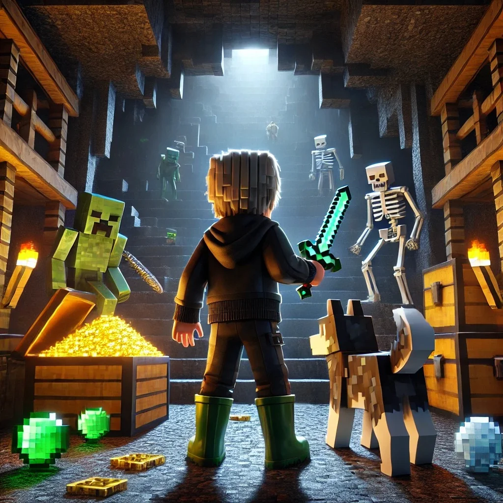

Damián se despertó temprano una mañana, emocionado por la aventura que le esperaba. Había escuchado rumores sobre una mina misteriosa llena de tesoros escondidos y mobs peligrosos. Con su espada de diamante en mano y su fiel lobo Sader a su lado, decidió emprender el viaje.

Al llegar a la entrada de la mina, Damián sintió un escalofrío. La oscuridad parecía susurrar secretos y peligros. Sin embargo, su curiosidad era más fuerte que su miedo, así que encendió una antorcha y entró con cuidado.

La mina estaba llena de túneles y pasadizos estrechos. A medida que avanzaba, escuchó ruidos extraños: el crujido de piedras cayendo y el eco de pasos lejanos. «Vamos, Sader, tenemos que ser valientes», susurró Damián a su lobo, quien movió la cola en señal de acuerdo.

De repente, Damián vio algo brillar en la oscuridad. Al acercarse, descubrió una sala llena de cofres. Su corazón latía con fuerza mientras abría uno de los cofres y encontró diamantes, oro y esmeraldas. «¡Hemos encontrado el tesoro, Sader!», exclamó emocionado.

Pero su alegría duró poco. Un ruido fuerte resonó detrás de él, y al voltear, vio que un grupo de esqueletos se acercaba rápidamente, listos para atacar. Sin pensarlo dos veces, Damián empuñó su espada y comenzó a luchar. Sader, con sus dientes afilados, mordía a los esqueletos, protegiendo a su dueño.

La batalla fue intensa, pero Damián no se rindió. Con cada golpe de su espada, los esqueletos se desmoronaban en una lluvia de huesos. Finalmente, el último esqueleto cayó, y la mina quedó en silencio una vez más.

«Lo logramos, Sader», dijo Damián, respirando con dificultad. «Hemos vencido a los esqueletos y encontrado el tesoro.»

Sin embargo, la aventura aún no había terminado. En un rincón oscuro de la sala, una puerta secreta se abrió lentamente, revelando un pasadizo aún más profundo. Con la antorcha en alto, Damián y Sader se adentraron en el pasadizo, listos para descubrir los secretos que aún guardaba la mina misteriosa.

Y así, Damián continuó su aventura, sabiendo que, con su valentía y su leal amigo Sader a su lado, no había nada que no pudiera enfrentar en el mundo de Minecraft.

